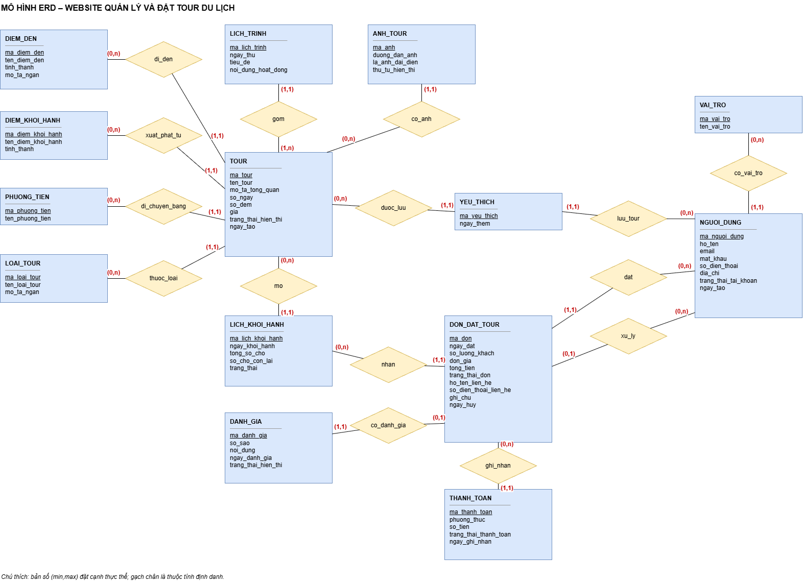

# TravelTour – Website quản lý và đặt tour du lịch

Đồ án chuyên ngành – Trường Đại học Trà Vinh

- **Sinh viên:** Vương Hào Khang – MSSV 110123018 – Lớp DA23TTA
- **Giảng viên hướng dẫn:** ThS. Trầm Hoàng Nam

## Giới thiệu

TravelTour là website đặt tour du lịch trong nước. Khách hàng xem tour, tìm kiếm, lọc theo điểm đến, loại tour và ngày khởi hành, rồi đặt chỗ trực tuyến. Nhân viên và quản trị viên dùng cùng hệ thống để quản lý tour, lịch khởi hành và đơn đặt tour.

Hệ thống có ba vai trò:

| Vai trò | Chức năng chính |
|---|---|
| Khách hàng | Đăng ký, đăng nhập, xem và tìm kiếm tour, đặt tour, xem lịch sử và hủy đơn chưa xác nhận, đánh giá tour đã đi, lưu tour yêu thích, cập nhật hồ sơ |
| Nhân viên | Xác nhận, hoàn tất hoặc hủy đơn đặt tour, ghi nhận thanh toán |
| Quản trị viên | Quản lý tour (lịch trình, ảnh), lịch khởi hành, danh mục (điểm đến, điểm khởi hành, phương tiện, loại tour), đánh giá, khách hàng, nhân viên; xem thống kê doanh thu |

Thanh toán chỉ được ghi nhận trạng thái (chưa thanh toán, đã đặt cọc, đã thanh toán), không kết nối cổng thanh toán thật.

### Sơ đồ use case tổng quát


### Mô hình ERD

Cơ sở dữ liệu gồm 14 bảng: 11 bảng cốt lõi và 3 bảng mở rộng (loại tour, đánh giá, yêu thích).



File gốc (mở bằng [draw.io](https://app.diagrams.net/)) nằm trong `docs/`: `UseCase_WebsiteDatTour.drawio`, `ERD_WebsiteDatTour.drawio`.

## Công nghệ

| Thành phần | Công nghệ |
|---|---|
| Frontend | React (Vite), React Router, Axios, CSS thuần, Font Awesome |
| Backend | Node.js, Express, RESTful API, ES Modules |
| Cơ sở dữ liệu | SQL Server (thư viện `mssql`) |
| Xác thực, bảo mật | JWT, bcrypt |
| Tải ảnh | Multer |

## Cấu trúc thư mục

```
├── backend/
│   ├── src/
│   │   ├── config/        # kết nối SQL Server
│   │   ├── routes/        # khai báo đường dẫn API
│   │   ├── controllers/   # nhận request, trả response
│   │   ├── services/      # xử lý nghiệp vụ
│   │   ├── models/        # truy vấn SQL có tham số
│   │   ├── middlewares/   # xác thực, phân quyền, xử lý lỗi
│   │   ├── utils/
│   │   └── app.js
│   ├── database/          # schema.sql, seed.sql
│   ├── scripts/           # tiện ích (sinh mã băm mật khẩu mẫu)
│   └── uploads/           # ảnh tour được tải lên
├── frontend/
│   ├── public/            # favicon, ảnh banner
│   └── src/
│       ├── api/           # axios và hàm gọi API
│       ├── components/    # thành phần dùng chung
│       ├── config/        # thông tin website, cấu hình banner
│       ├── pages/         # trang public, customer, staff, admin
│       ├── routes/
│       └── styles/
└── docs/                  # sơ đồ use case, mô hình ERD, báo cáo đồ án
```

## Yêu cầu cài đặt

- [Node.js](https://nodejs.org/) 20 trở lên (kèm npm)
- SQL Server (bản Express là đủ) và SQL Server Management Studio (SSMS)
- Git

## Cài đặt

### 1. Tải mã nguồn

```bash
git clone https://github.com/khang29405/cn-da23tta-vuonghaokhang-traveltour-nodejs.git
cd cn-da23tta-vuonghaokhang-traveltour-nodejs
```

### 2. Tạo cơ sở dữ liệu

Mở SSMS, kết nối tới SQL Server, rồi chạy lần lượt hai file trong `backend/database/`:

1. `schema.sql`: tạo cơ sở dữ liệu `TourDuLich` và 14 bảng.
2. `seed.sql`: thêm dữ liệu mẫu (vai trò, tài khoản mẫu, danh mục).

Chạy lại `schema.sql` sẽ xóa toàn bộ dữ liệu cũ để tạo lại từ đầu.

Backend đăng nhập bằng tài khoản SQL Server, nên cần bật chế độ **SQL Server and Windows Authentication** và có một tài khoản đăng nhập (ví dụ `sa`). Hướng dẫn chi tiết: [backend/database/README.md](backend/database/README.md).

### 3. Cấu hình và chạy backend

```bash
cd backend
npm install
```

Sao chép `.env.example` thành `.env`, rồi sửa các giá trị cho đúng với máy:

```env
PORT=5000
DB_SERVER=localhost\SQLEXPRESS   # SQL Server bản đầy đủ không có instance thì ghi: localhost
DB_NAME=TourDuLich
DB_USER=sa
DB_PASSWORD=mat_khau_tai_khoan_sa
JWT_SECRET=chuoi_bi_mat_tu_dat
```

Chạy backend:

```bash
npm run dev      # chế độ phát triển, tự khởi động lại khi sửa code
# hoặc
npm start
```

Kiểm tra: mở <http://localhost:5000/api/health>. Backend chạy đúng và kết nối được cơ sở dữ liệu sẽ trả về `"success": true` cùng `"connected": true`. Nếu trả mã 503, xem lý do lỗi in trên terminal của backend (thường là sai `DB_SERVER` hoặc mật khẩu).

### 4. Cấu hình và chạy frontend

Mở một cửa sổ terminal khác:

```bash
cd frontend
npm install
```

Sao chép `.env.example` thành `.env`:

```env
VITE_API_URL=http://localhost:5000/api
```

Chạy frontend:

```bash
npm run dev
```

Mở địa chỉ Vite in ra trên terminal (mặc định <http://localhost:5173>).

## Tài khoản mẫu

Có sau khi chạy `seed.sql`. Cả 3 tài khoản dùng chung mật khẩu **`Matkhau@123`**. Đăng nhập tại `http://localhost:5173/dang-nhap`, hệ thống tự chuyển tới trang của từng vai trò.

| Vai trò | Email | Trang sau khi đăng nhập |
|---|---|---|
| Quản trị viên | `quantri@traveltour.vn` | `/admin` (trang quản trị) |
| Nhân viên | `nhanvien@traveltour.vn` | `/nhan-vien` (xử lý đơn đặt tour) |
| Khách hàng | `khachhang@gmail.com` | `/` (trang chủ) |

## Lệnh thường dùng

| Thư mục | Lệnh | Tác dụng |
|---|---|---|
| `backend` | `npm run dev` | Chạy API với nodemon |
| `backend` | `npm start` | Chạy API |
| `backend` | `npm run hash-password -- <mat_khau>` | Sinh mã băm bcrypt cho tài khoản mẫu trong `seed.sql` |
| `frontend` | `npm run dev` | Chạy giao diện ở chế độ phát triển |
| `frontend` | `npm run build` | Đóng gói giao diện vào `frontend/dist` |
| `frontend` | `npm run preview` | Xem thử bản đã đóng gói |
| `frontend` | `npm run lint` | Kiểm tra mã nguồn bằng oxlint |

## Tài liệu

Các tài liệu của đồ án đặt trong thư mục `docs/`:

- Sơ đồ use case và mô hình ERD (file `.png` và file gốc `.drawio`).
- Báo cáo đồ án (sẽ bổ sung khi hoàn thành).

## Lưu ý

- Thông tin công ty hiển thị trên website (tên, hotline, địa chỉ) là dữ liệu mẫu, khai báo ở `frontend/src/config/siteInfo.js`.
